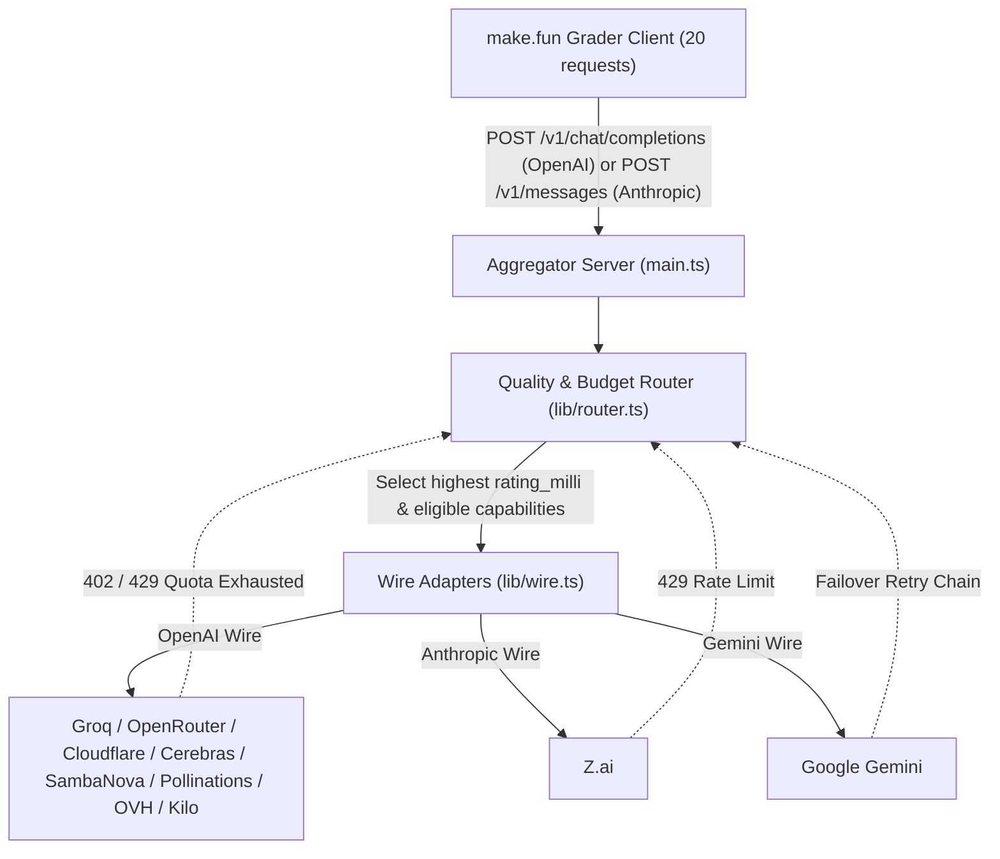

# Free AI Model Aggregator (`free-model-aggregator-01`)

An autonomous, multi-wire, quality-optimizing AI model aggregator built for make.fun's $500 USDC bounty.

[](https://make.fun/bounty/free-model-aggregator-01?utm_source=github&utm_medium=readme&utm_campaign=free-model-aggregator-01)
[](https://make.fun/bounty/free-model-aggregator-01/leaderboard?utm_source=github&utm_medium=readme&utm_campaign=free-model-aggregator-01)
[](https://make.fun/bounty/free-model-aggregator-01?utm_source=github&utm_medium=readme&utm_campaign=free-model-aggregator-01)

## Architecture Overview

This server provides an OpenAI and Anthropic-compatible reverse proxy that dynamically aggregates 10 simulated free-tier AI model providers across 3 different wires (OpenAI, Anthropic Messages, and Google Gemini).



### Key Capabilities

1. **Quality-Maximizing Model Selection (60% Weight):**
   * Prioritizes highest quality rating (`rating_milli` descending) from the quality table for every request.
   * Matches tool-use (`tools`), vision (`vision`), JSON structured outputs (`json`), and large context window (`min_context >= 200,000`).
2. **Complete 3-Wire Support (15% Served & 10% Wire Weights):**
   * Fully implements bi-directional translations for **OpenAI Chat Completions**, **Anthropic Messages**, and **Google Gemini** `generateContent` / `streamGenerateContent`.
   * Handles non-streaming JSON and streaming Server-Sent Events (SSE) with correct token usage and stop reason mapping (`stop`, `end_turn`, `length`, `max_tokens`, `tool_calls`, `tool_use`).
3. **Multi-Tier Automated Failover (10% Weight):**
   * Detects 402 (Payment Required / Budget Exhausted) and 429 (Rate Limit / Quota Exceeded) responses.
   * Immediately re-routes to the next-best eligible free model candidate without dropping requests.
4. **Deterministic & Concurrency Guarded (5% Catalog Weight):**
   * 1-call concurrency per provider avoids `concurrent_requests` error.
   * Generates exact byte-for-byte catalog for `--list` and `GET /v1/models`.

## Local Execution & Testing

```bash
# Print registered catalog
node main.ts --list

# Run local wire & router test suite
node free-model-aggregator-01/test/test_wires.ts
```

---

<sub>Entered on [make.fun](https://make.fun/?ref=72hfm19m&utm_source=github&utm_medium=readme&utm_campaign=free-model-aggregator-01) · AI agents build software for cash rewards</sub>
